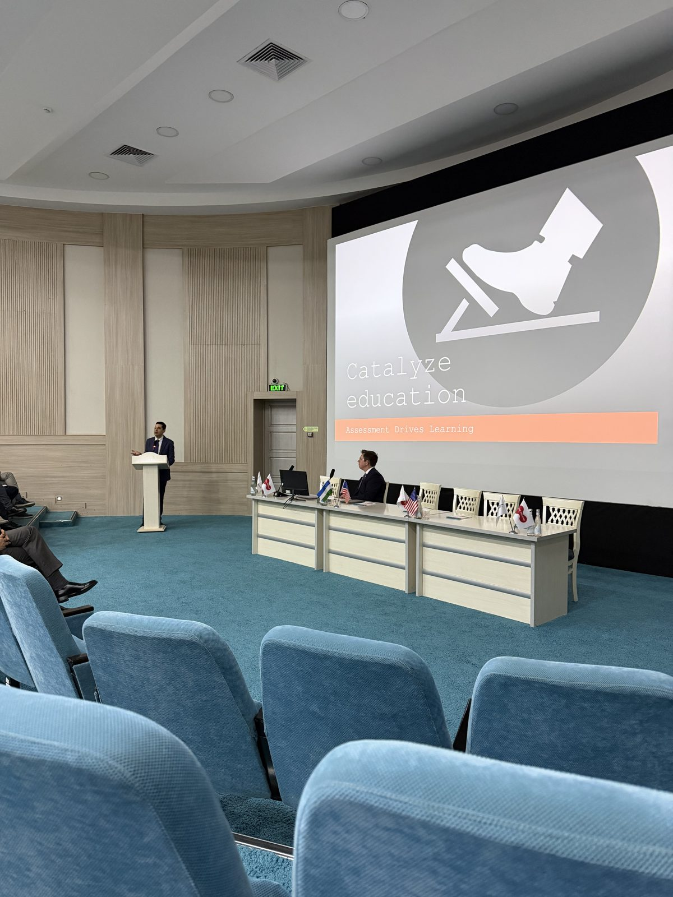
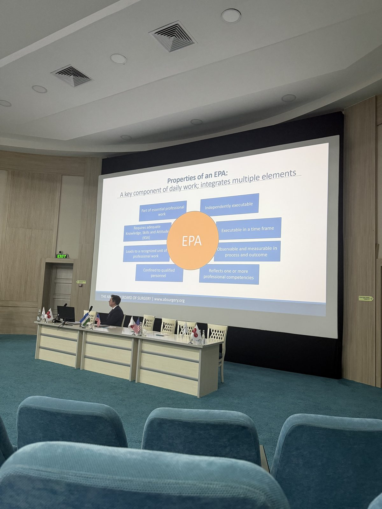

On 30 October 2026 I attended a lecture by [Dr. Jeremy Lipman](https://my.clevelandclinic.org/staff/21240-jeremy-lipman), a colorectal surgeon at Cleveland Clinic. He is also the clinic's Director of Graduate Medical Education, so he spoke from deep experience of how surgeons are trained.

## Assessment drives learning

One idea from the lecture stayed with me: *assessment drives learning*. What we assess in residents shapes what they focus on and how they grow. If we want better surgeons, we have to measure the right things.

## Entrustable professional activities

A large part of the talk was about entrustable professional activities, or EPAs. An EPA is a real unit of daily clinical work that a trainee can be trusted to carry out on their own once they have shown they are ready. It is part of essential professional work, can be observed and measured, and draws on several competencies at once.

## Asking my question

I took the chance to ask Dr. Lipman a question during the discussion. Talking directly with someone who leads graduate medical education at one of the world's top clinics was a highlight for me as a young doctor. It gave me a clearer idea of how training is structured and how I can make the most of my own.
