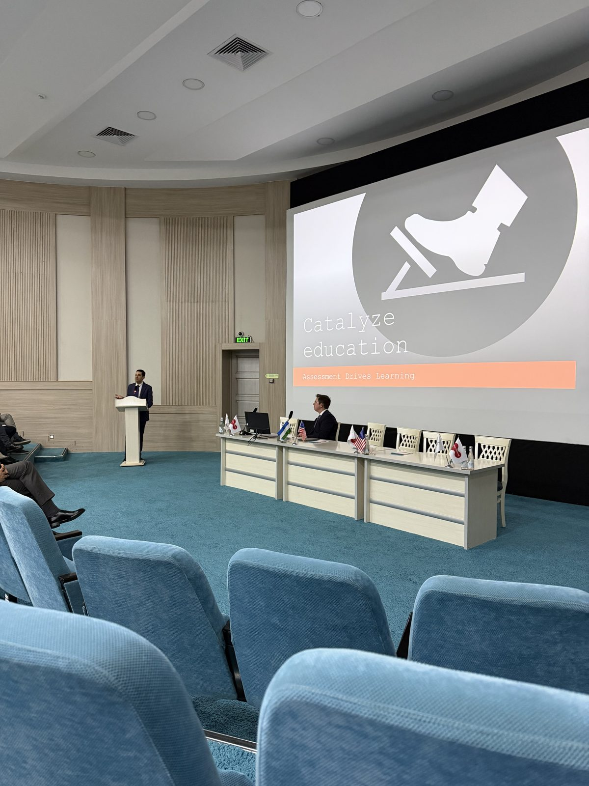
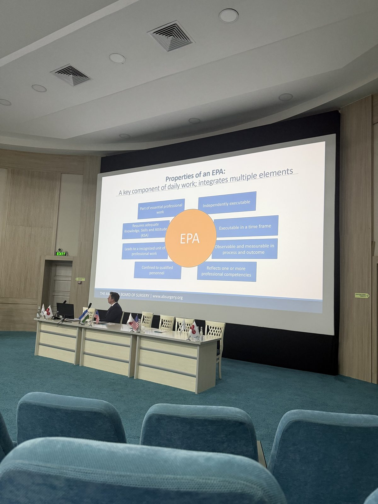

30 октября 2026 года я побывал на лекции [доктора Джереми Липмана](https://my.clevelandclinic.org/staff/21240-jeremy-lipman), колоректального хирурга Cleveland Clinic. Он также руководит последипломным медицинским образованием в клинике, поэтому говорил на основе большого опыта подготовки хирургов.

## Оценивание направляет обучение

Одна мысль из лекции особенно запомнилась: *оценивание направляет обучение*. То, что мы оцениваем у резидентов, определяет, на чём они сосредоточены и как растут. Чтобы готовить лучших хирургов, нужно измерять правильные вещи.

## Доверяемые профессиональные действия

Большая часть лекции была посвящена доверяемым профессиональным действиям (EPA). EPA — это реальная единица ежедневной клинической работы, которую можно доверить обучающемуся выполнять самостоятельно, как только он показал свою готовность. Она входит в основную профессиональную работу, поддаётся наблюдению и измерению и опирается сразу на несколько компетенций.

## Мой вопрос

Во время обсуждения я задал доктору Липману вопрос. Поговорить напрямую с человеком, который руководит последипломным образованием в одной из лучших клиник мира, было для меня как для молодого врача очень ценно. Я лучше понял, как устроена подготовка и как извлечь максимум из своего обучения.
