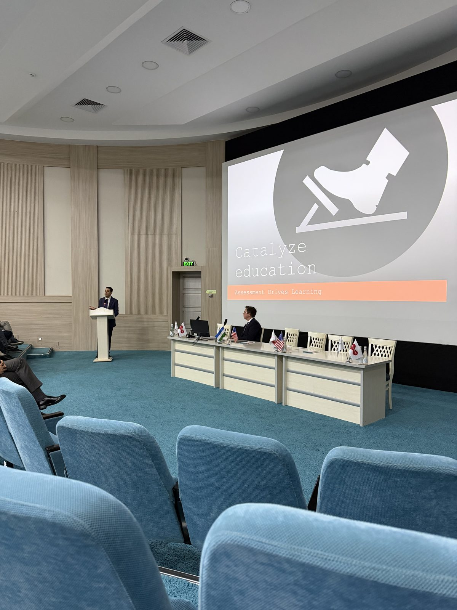
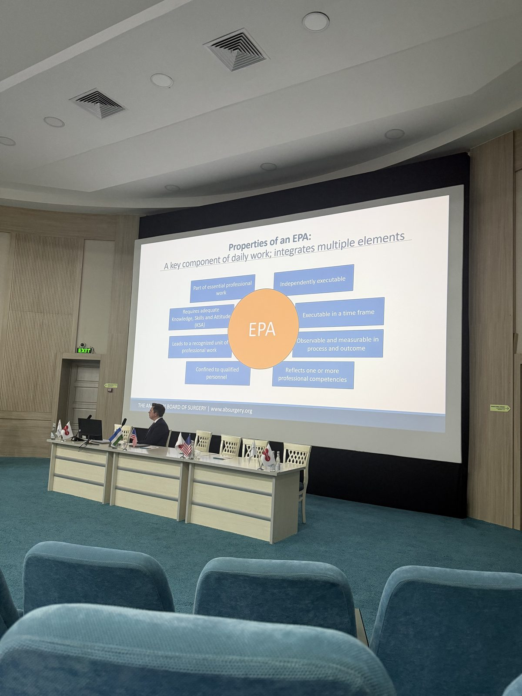
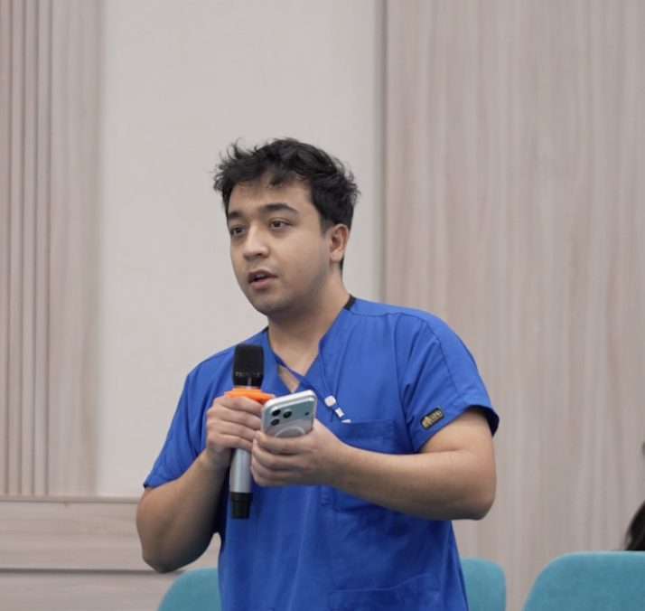

2026 yil 30 oktyabrda Cleveland Clinic kolorektal jarrohi [doktor Jeremy Lipman](https://my.clevelandclinic.org/staff/21240-jeremy-lipman)ning maʼruzasida qatnashdim. U klinikada diplomdan keyingi tibbiy taʼlimga ham rahbarlik qiladi, shuning uchun jarrohlarni tayyorlash boʻyicha katta tajribasi asosida gapirdi.

## Baholash oʻqishni yoʻnaltiradi

Maʼruzadagi bir fikr esimda qoldi: *baholash oʻqishni yoʻnaltiradi*. Rezidentlarda nimani baholasak, ular shunga eʼtibor qaratadi va shunday rivojlanadi. Yaxshiroq jarrohlar tayyorlash uchun toʻgʻri narsalarni oʻlchash kerak.

## Ishonib topshiriladigan kasbiy faoliyatlar

Maʼruzaning katta qismi ishonib topshiriladigan kasbiy faoliyatlar (EPA) haqida boʻldi. EPA bu kundalik klinik ishning real birligi boʻlib, oʻquvchi tayyorligini koʻrsatgach, uni mustaqil bajarishga ishonib topshirish mumkin. U asosiy kasbiy ishning bir qismi, kuzatish va oʻlchash mumkin, va bir vaqtning oʻzida bir nechta kompetensiyalarga tayanadi.

## Mening savolim

Muhokama paytida doktor Lipmanga savol berdim.

Dunyoning eng yaxshi klinikalaridan birida diplomdan keyingi taʼlimga rahbarlik qiladigan inson bilan bevosita suhbatlashish yosh shifokor sifatida men uchun juda qimmatli boʻldi. Tayyorgarlik qanday tuzilgani va oʻz taʼlimimdan qanday qilib maksimal foyda olishimni aniqroq tushundim.
