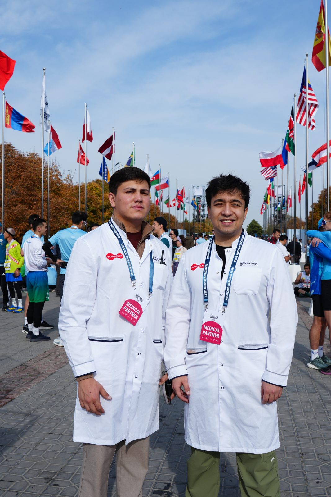
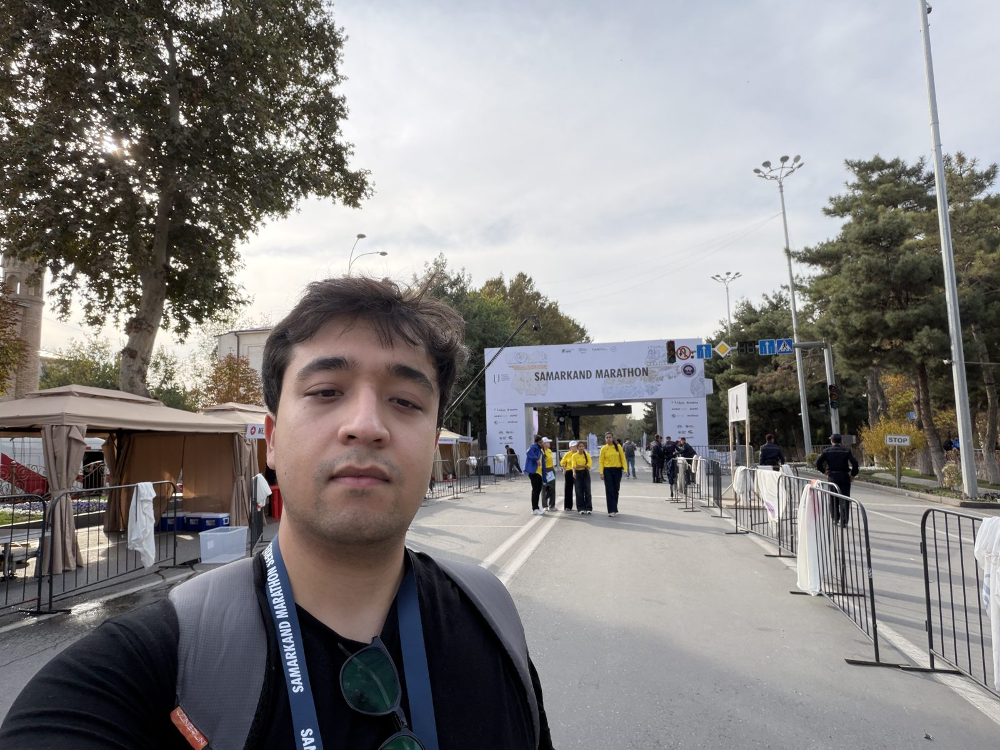

On 7 and 8 November 2026 I served as a field doctor at the Samarkand Marathon. Akfa Medline University Hospital was the event's medical partner, and I was part of the team keeping runners safe over the race weekend.

## Behind the medical post

Our team worked from medical posts set up along the route, ready to help any runner who needed it. With a radio in my pocket, I stayed in touch with the rest of the medical team so we could respond quickly wherever we were needed.

## At the finish line

Runners came to Samarkand from many countries, and the flags of their nations lined the start area. The finish line is where a field doctor has to be most alert. After hours of running, people arrive exhausted, and some need help straight away.

## What I took away

Medicine outside the hospital is different. You work with fewer resources, decisions have to be quick, and teamwork matters even more. I am grateful to Akfa Medline for the chance to be part of the medical team at such a large international event, and I would gladly do it again.
