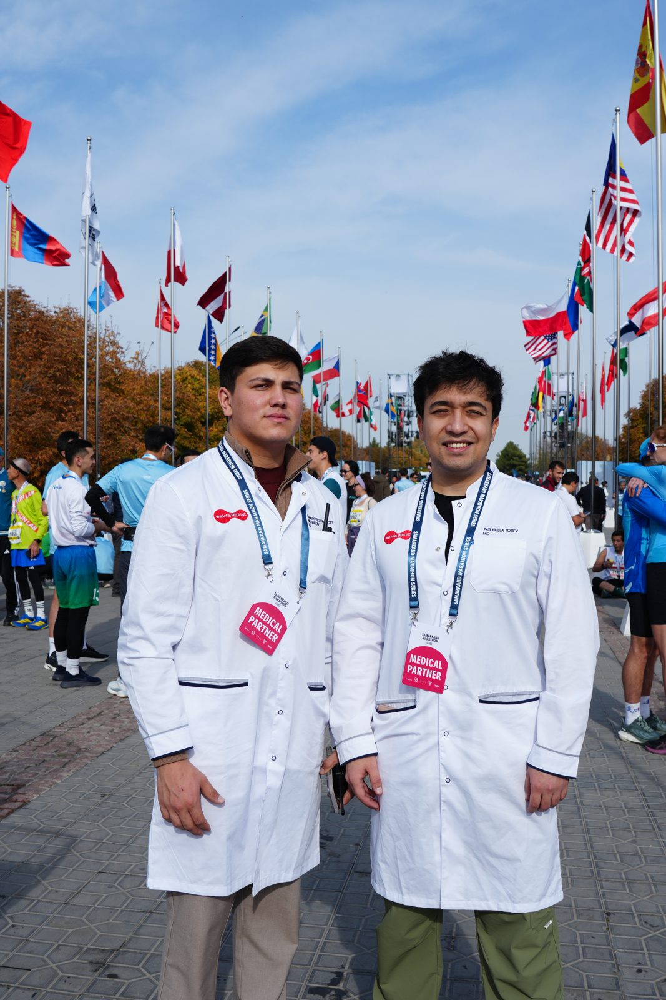
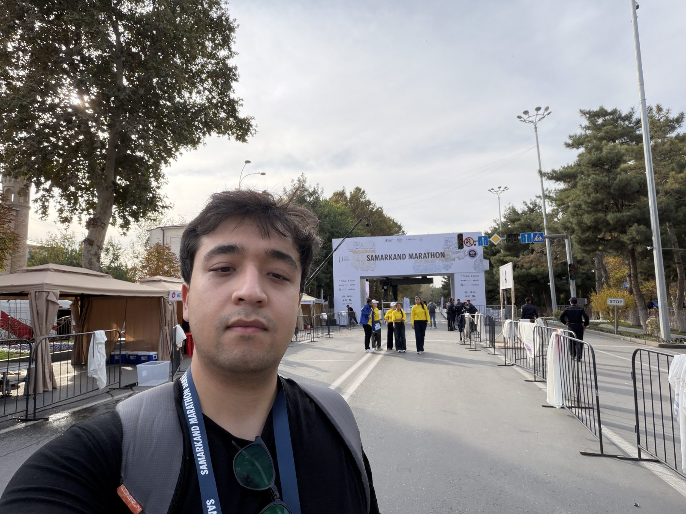

7 и 8 ноября 2026 года я работал врачом на дистанции Самаркандского марафона. Медицинским партнёром мероприятия была Akfa Medline University Hospital, и я входил в команду, которая обеспечивала безопасность бегунов в эти дни.

## На медицинском пункте

Наша команда работала на медицинских пунктах вдоль трассы, готовая помочь любому бегуну. С рацией в кармане я держал связь с остальной медицинской командой, чтобы мы могли быстро реагировать там, где нужна помощь.

## На финише

Бегуны приехали в Самарканд из многих стран, и флаги их государств украшали стартовую зону. Финиш — место, где врачу на дистанции нужно быть особенно внимательным. После долгого бега люди приходят измотанными, и некоторым помощь нужна сразу.

## Что я вынес из этого

Медицина вне больницы — другая. Ресурсов меньше, решения нужно принимать быстро, а командная работа становится ещё важнее. Я благодарен Akfa Medline за возможность быть частью медицинской команды на таком крупном международном событии и с радостью сделаю это снова.
