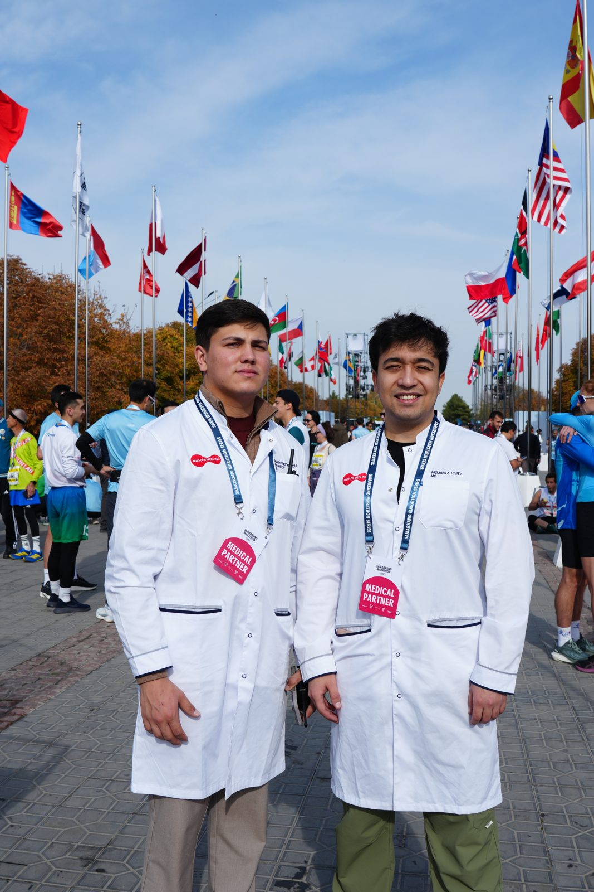
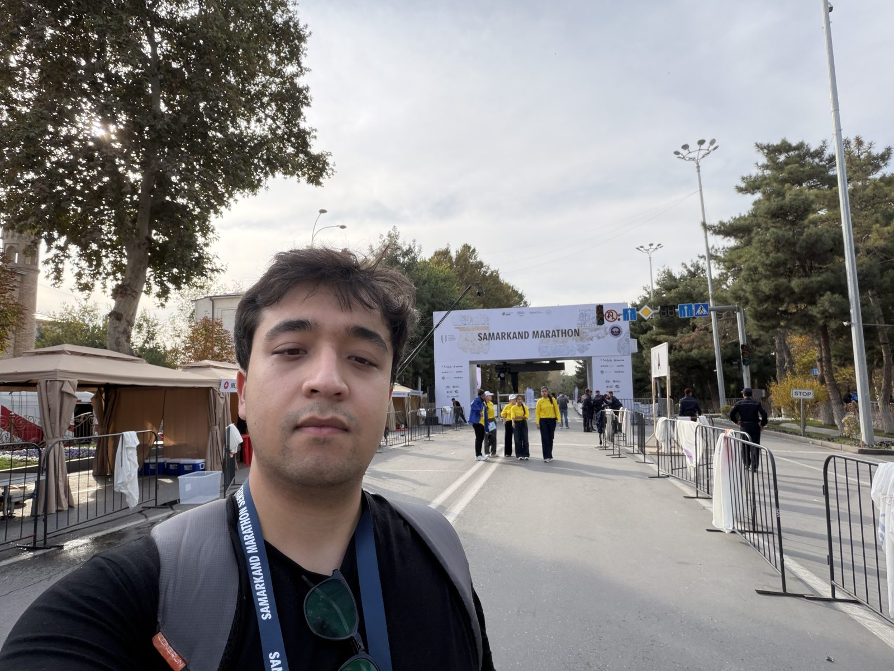

2026 yil 7 va 8 noyabr kunlari Samarqand marafonida dala shifokori boʻlib xizmat qildim. Akfa Medline University Hospital tadbirning tibbiy hamkori edi va men musobaqa kunlari yuguruvchilar xavfsizligini taʼminlagan jamoa tarkibida boʻldim.

## Tibbiy punktda

Jamoamiz yoʻl boʻylab joylashgan tibbiy punktlarda ishladi va yordamga muhtoj har qanday yuguruvchiga koʻmak berishga tayyor turdi. Choʻntagimdagi ratsiya orqali tibbiy jamoaning qolgan aʼzolari bilan aloqada boʻldim, shunda kerakli joyga tezda yetib bora olardik.

## Marra chizigʻida

Samarqandga koʻplab davlatlardan yuguruvchilar keldi va ularning bayroqlari start hududini bezab turdi. Marra chizigʻi dala shifokori eng hushyor boʻlishi kerak boʻlgan joy. Uzoq yugurishdan keyin odamlar holdan toyib keladi va baʼzilariga darhol yordam kerak boʻladi.

## Nimalarni oʻrgandim

Kasalxonadan tashqaridagi tibbiyot boshqacha. Resurslar kamroq, qarorlarni tez qabul qilish kerak va jamoaviy ish yanada muhim. Bunday yirik xalqaro tadbirda tibbiy jamoaning bir qismi boʻlish imkoniyati uchun Akfa Medlinega minnatdorman va buni yana bajonidil takrorlayman.
