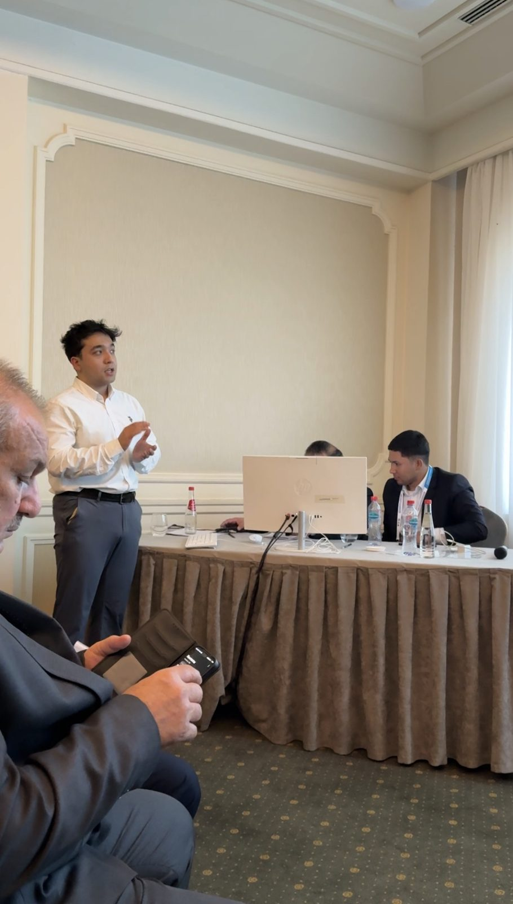
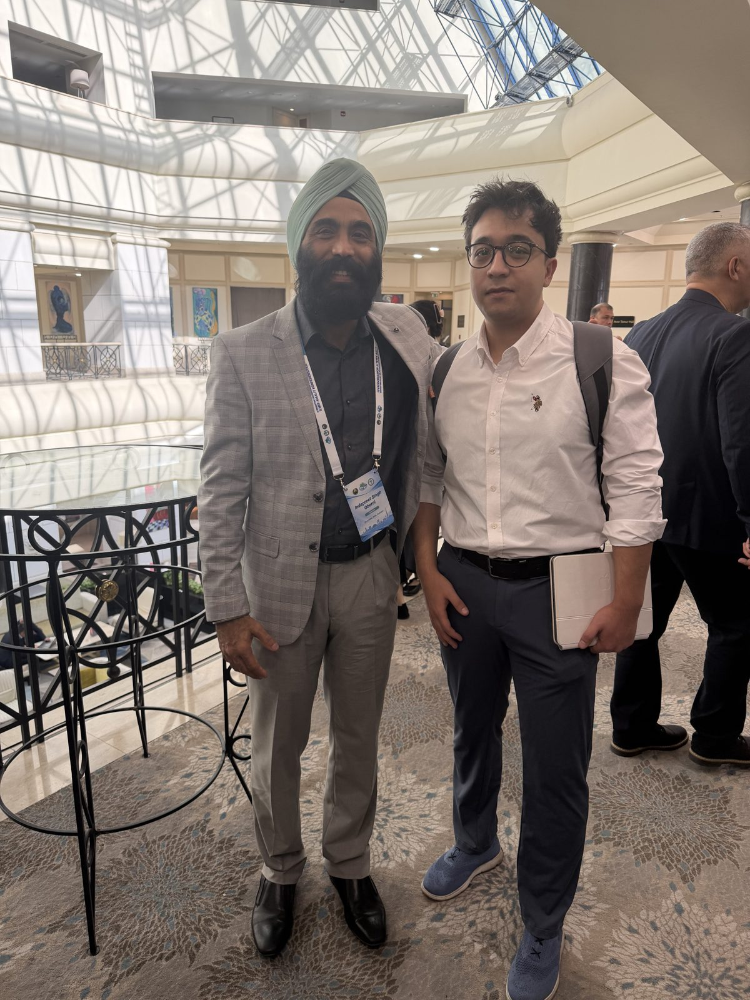
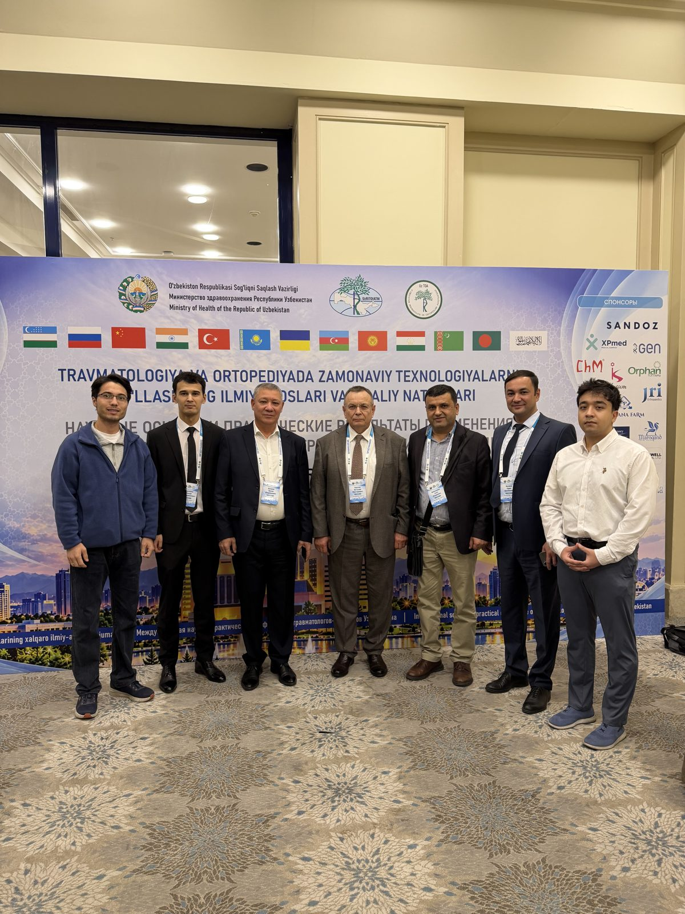
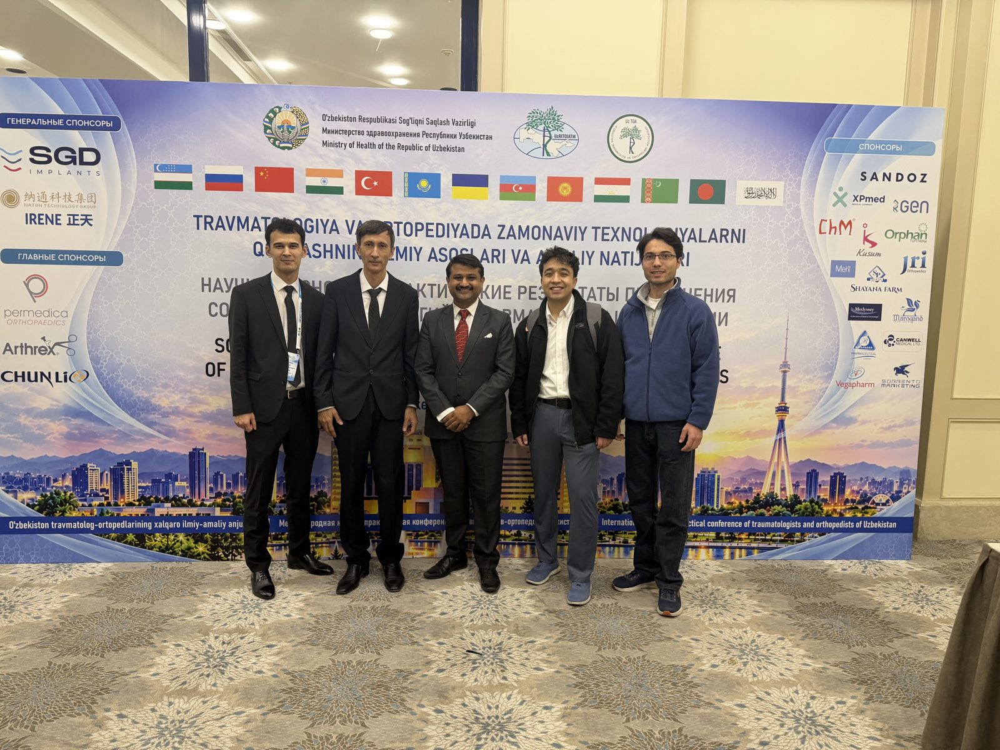

On 24 October 2026 I took part in the Scientific and Practical Conference of Traumatologists and Orthopedists of Uzbekistan in Tashkent. I gave a talk, operated an arthroplasty robot for the first time, and came home with a stack of new contacts.

This year's theme was *Scientific Foundations and Practical Results of the Use of Modern Technologies in Traumatology and Orthopedics*. The conference was organized by the Ministry of Health of the Republic of Uzbekistan, the Republican Specialized Scientific and Practical Medical Center of Traumatology and Orthopedics, and the Association of Traumatologists and Orthopedists.

## Presenting on arthroscopy portals

My talk was about arthroscopy portals: where we enter the joint, and why that choice shapes the whole operation. A well-placed portal gives a clear view and easy instrument access. A poorly placed one fights you for the entire case and puts nearby nerves and vessels at risk.

I built the presentation around three questions every arthroscopist answers before the first incision:

1. **Where are the landmarks?** Palpating and marking bony landmarks before the joint swells with fluid.
2. **What does each portal let me see and reach?** Choosing a viewing portal and working portals that do not crowd each other.
3. **What is nearby that I must protect?** Knowing the safe zones around each entry point.

The discussion afterwards was the best part. Colleagues shared their own preferred portals and the tricks they use in difficult cases.

## Getting hands-on with an arthroplasty robot

The highlight of the day for me was trying an arthroplasty robot myself. Reading about robotic joint replacement is one thing. Holding the arm and feeling it guide your movement is another.

What struck me most was how the system turns the surgical plan into physical boundaries. You plan implant position and bone cuts in advance, and the robot helps you stay within them. The surgeon is still in charge, but with an extra layer of precision and consistency.

It made me think about what this technology could mean for patients here: more accurate implant alignment, more reproducible results, and new ways to train young surgeons.

## Meeting colleagues from across the field

Between sessions I met many professionals who lead the way in their areas: experienced surgeons, researchers and young specialists just starting out. I exchanged contact information with many of them. Those connections open the door to sharing cases, asking for a second opinion, and working together on future research.

## Looking ahead

I left the conference with feedback on my work, first-hand experience with robotic arthroplasty, and a wider professional network. My thanks to the organizers for an excellent programme, and to everyone who came to my talk and joined the discussion.
