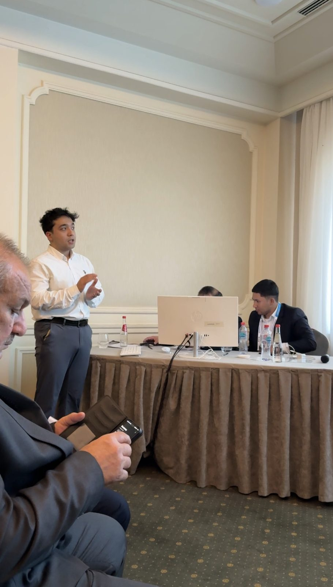
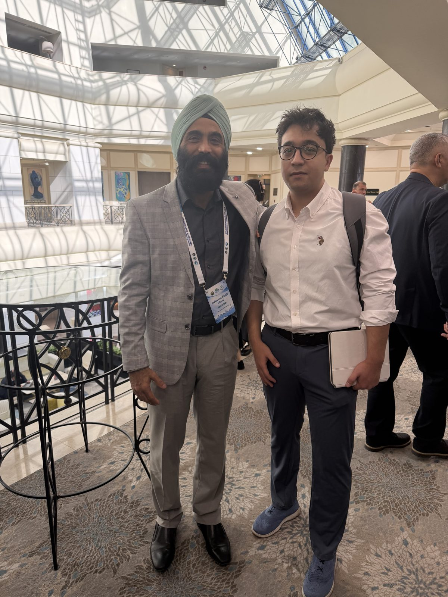
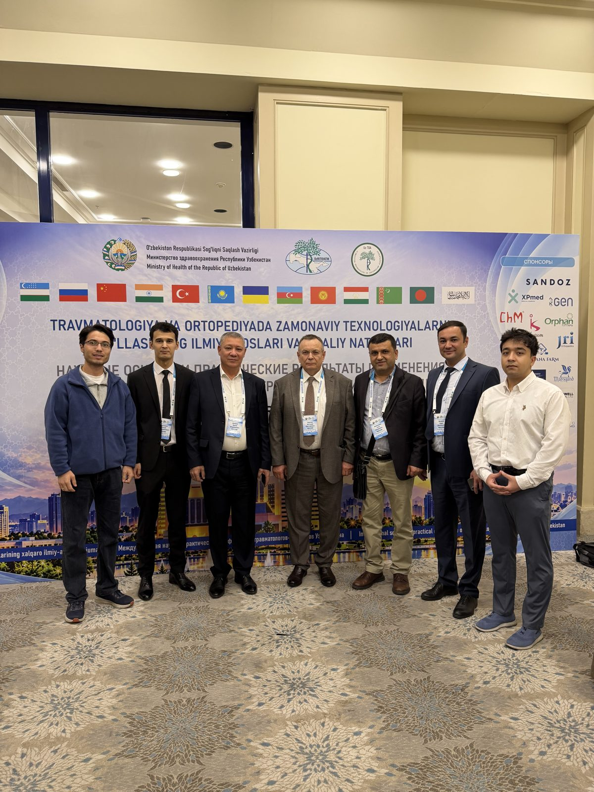
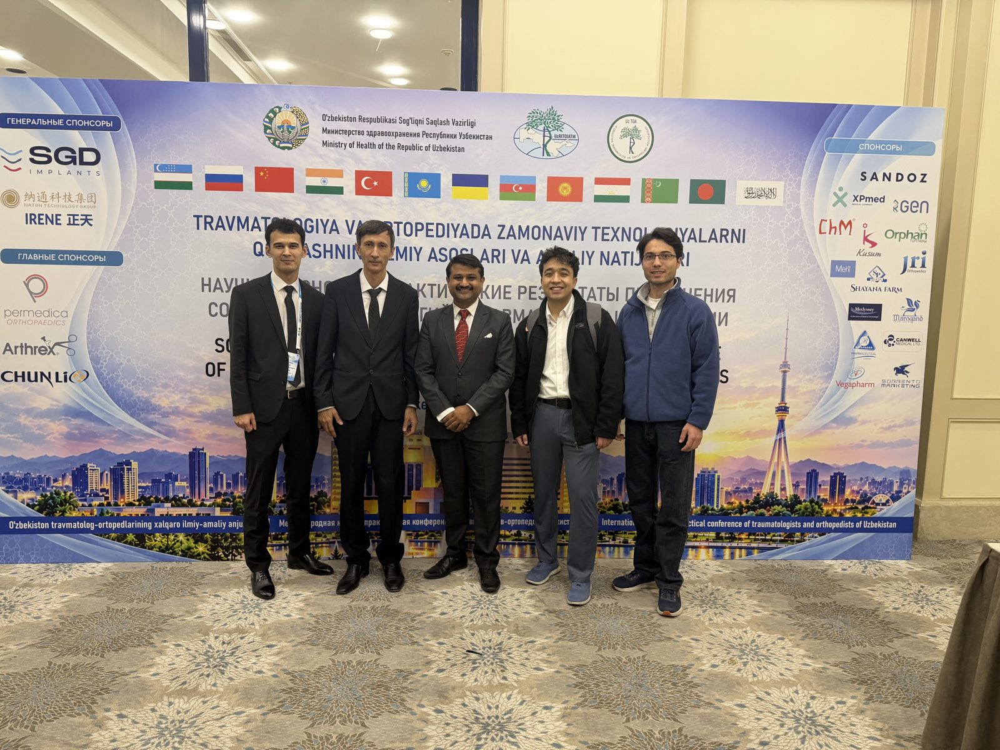

24 октября 2026 года я принял участие в научно-практической конференции травматологов-ортопедов Узбекистана в Ташкенте. Я выступил с докладом, впервые поработал с роботом для артропластики и обзавёлся множеством новых контактов.

Тема конференции в этом году — *Научные основы и практические результаты применения современных технологий в травматологии и ортопедии*. Организаторами выступили Министерство здравоохранения Республики Узбекистан, Республиканский специализированный научно-практический медицинский центр травматологии и ортопедии и Ассоциация травматологов-ортопедов Республики Узбекистан.

## Доклад о портах в артроскопии

Мой доклад был посвящён артроскопическим портам: где мы входим в сустав и почему этот выбор определяет ход всей операции. Правильно установленный порт даёт чёткий обзор и удобный доступ для инструментов. Неудачный порт мешает на протяжении всей операции и подвергает риску близлежащие нервы и сосуды.

Я построил выступление вокруг трёх вопросов, на которые артроскопист отвечает до первого разреза:

1. **Где ориентиры?** Пальпация и разметка костных ориентиров до того, как сустав отечёт от жидкости.
2. **Что позволяет увидеть и достать каждый порт?** Выбор оптического и рабочих портов, которые не мешают друг другу.
3. **Что рядом нужно защитить?** Знание безопасных зон вокруг каждой точки входа.

Самой интересной частью стала дискуссия после доклада. Коллеги рассказали о своих любимых портах и приёмах, которые они используют в сложных случаях.

## Работа с роботом для артропластики

Главным событием дня для меня стала возможность самому попробовать робота для артропластики. Читать о роботизированном эндопротезировании — одно. Держать манипулятор и чувствовать, как он направляет твоё движение, — совсем другое.

Больше всего меня впечатлило, как система превращает хирургический план в физические границы. Положение импланта и костные резы планируются заранее, а робот помогает оставаться в их пределах. Хирург по-прежнему всё контролирует, но с дополнительной точностью и стабильностью.

Я задумался о том, что эта технология может дать нашим пациентам: более точную установку импланта, воспроизводимые результаты и новые способы обучения молодых хирургов.

## Знакомство с коллегами

Между сессиями я познакомился со многими специалистами, которые задают направление в своих областях: опытными хирургами, исследователями и молодыми врачами, которые только начинают путь. Со многими из них я обменялся контактами. Эти знакомства открывают возможность обсуждать клинические случаи, просить второе мнение и вместе работать над будущими исследованиями.

## Взгляд вперёд

Я уехал с конференции с отзывами о своей работе, личным опытом работы с роботом для артропластики и более широким кругом профессиональных контактов. Благодарю организаторов за прекрасную программу, а также всех, кто пришёл на мой доклад и участвовал в обсуждении.
