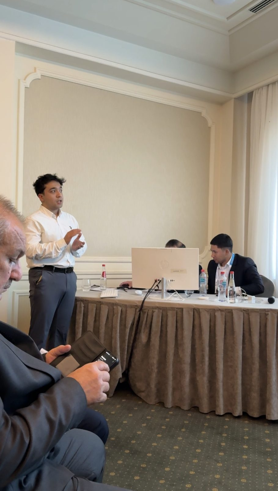
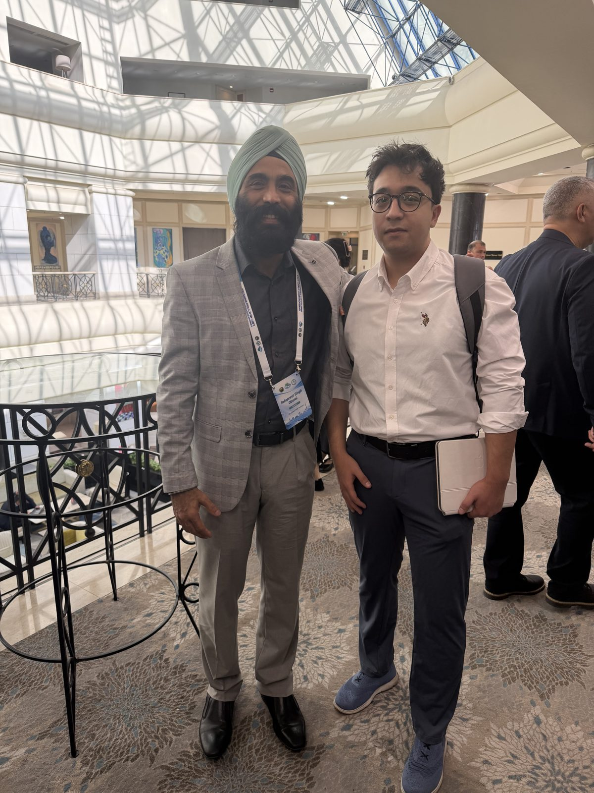
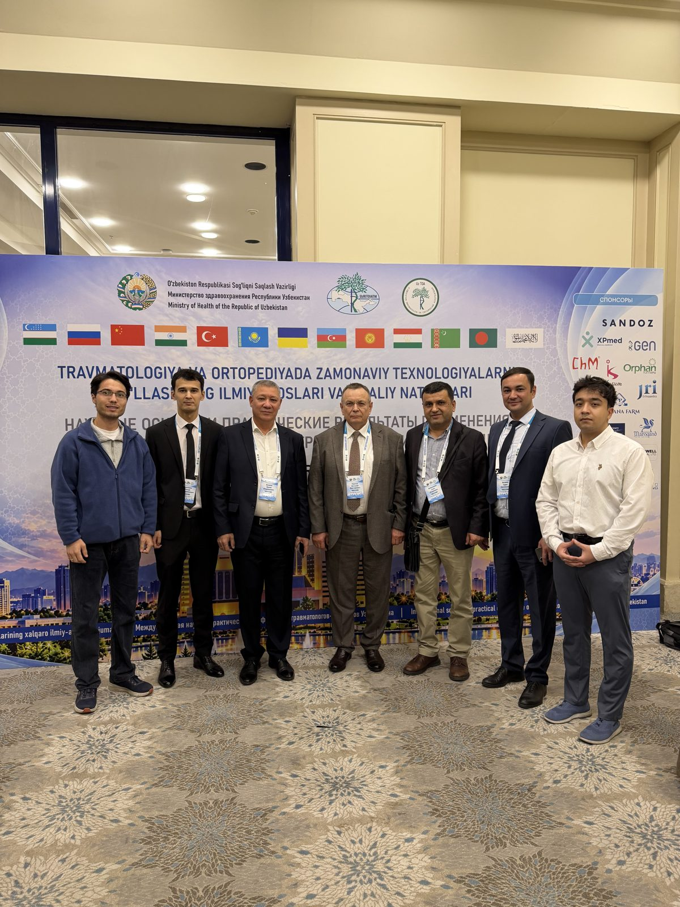
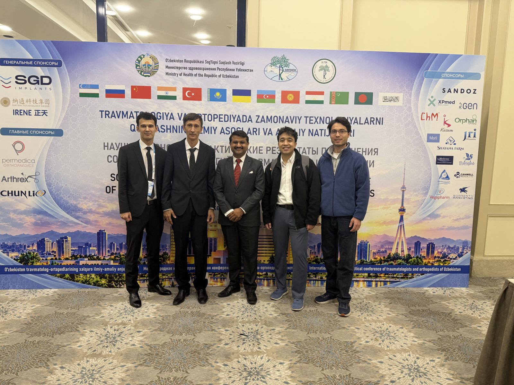

2026 yil 24 oktyabrda Toshkentda boʻlib oʻtgan Oʻzbekiston travmatolog-ortopedlarining ilmiy-amaliy anjumanida ishtirok etdim. Maʼruza qildim, ilk bor artroplastika robotida ishlab koʻrdim va koʻplab yangi tanishlar orttirdim.

Bu yilgi anjuman mavzusi *Travmatologiya va ortopediyada zamonaviy texnologiyalarni qoʻllashning ilmiy asoslari va amaliy natijalari* edi. Anjumanni Oʻzbekiston Respublikasi Sogʻliqni saqlash vazirligi, Respublika ixtisoslashtirilgan travmatologiya va ortopediya ilmiy-amaliy tibbiyot markazi hamda Travmatolog-ortopedlar assotsiatsiyasi tashkil etdi.

## Artroskopiya portlari haqida maʼruza

Maʼruzam artroskopiya portlari haqida edi: boʻgʻimga qayerdan kiramiz va bu tanlov butun operatsiyaga qanday taʼsir qiladi. Toʻgʻri joylashgan port aniq koʻrinish va asboblar uchun qulay kirishni taʼminlaydi. Notoʻgʻri joylashgan port esa butun operatsiya davomida xalaqit beradi va yaqin atrofdagi nerv va tomirlarni xavf ostiga qoʻyadi.

Taqdimotni har bir artroskopist birinchi kesmadan oldin javob beradigan uchta savol atrofida qurdim:

1. **Moʻljallar qayerda?** Boʻgʻim suyuqlik bilan shishishidan oldin suyak moʻljallarini paypaslab belgilash.
2. **Har bir port nimani koʻrish va nimaga yetishga imkon beradi?** Bir-biriga xalaqit bermaydigan koʻrish va ishchi portlarini tanlash.
3. **Yaqin atrofda nimani himoya qilishim kerak?** Har bir kirish nuqtasi atrofidagi xavfsiz zonalarni bilish.

Maʼruzadan keyingi muhokama eng qiziqarli qismi boʻldi. Hamkasblar oʻzlari afzal koʻradigan portlar va murakkab holatlarda qoʻllaydigan usullari bilan oʻrtoqlashdi.

## Artroplastika robotida ishlab koʻrish

Kunning men uchun eng yorqin lahzasi artroplastika robotini oʻzim sinab koʻrish boʻldi. Robotik boʻgʻim endoprotezlash haqida oʻqish bir narsa. Robot qoʻlini ushlab, uning harakatingizni yoʻnaltirayotganini his qilish esa butunlay boshqa.

Meni eng koʻp hayratga solgani tizim jarrohlik rejasini jismoniy chegaralarga aylantirishi boʻldi. Implant holati va suyak kesmalari oldindan rejalashtiriladi, robot esa shu chegaralarda qolishga yordam beradi. Boshqaruv jarrohda qoladi, lekin qoʻshimcha aniqlik va barqarorlik bilan.

Bu texnologiya bizdagi bemorlar uchun nimani anglatishi haqida oʻyladim: implantni aniqroq joylashtirish, takrorlanadigan natijalar va yosh jarrohlarni oʻqitishning yangi usullari.

## Hamkasblar bilan tanishuv

Sessiyalar orasida oʻz sohasida yetakchi boʻlgan koʻplab mutaxassislar bilan tanishdim: tajribali jarrohlar, tadqiqotchilar va endigina yoʻl boshlagan yosh mutaxassislar. Ularning koʻpchiligi bilan kontakt maʼlumotlarini almashdim. Bu aloqalar klinik holatlarni muhokama qilish, ikkinchi fikr soʻrash va kelajakdagi tadqiqotlarda hamkorlik qilish uchun yoʻl ochadi.

## Oldinga nazar

Anjumandan ishim boʻyicha fikr-mulohazalar, robotik artroplastika boʻyicha shaxsiy tajriba va kengroq kasbiy aloqalar bilan qaytdim. Ajoyib dastur uchun tashkilotchilarga hamda maʼruzamga kelib, muhokamada qatnashgan barchaga minnatdorchilik bildiraman.
